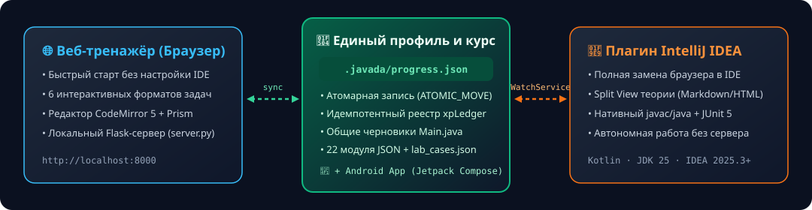

<div align="center">


<br/>

[](#быстрый-старт)
[](java-trainer/idea-plugin/README.md)
[](java-trainer/android-app/README.md)
[](java-trainer/idea-plugin/README.md)
[](java-trainer/README.md)
[](java-trainer/docs/DEVELOPMENT.md)
[](LICENSE)
[](https://t.me/Artem_Dobrokvashin)

**Читайте меньше «на потом» — пишите код с первого урока.**  
Локальный интерактивный тренажёр по Java с настоящим компилятором `javac`, мгновенной проверкой, геймификацией и синхронизацией прогресса между **браузером**, **IntelliJ IDEA** и **Android-смартфоном**. Без регистрации, платных подписок и облачной привязки.

[🚀 Быстрый старт](#быстрый-старт) · [🧩 Плагин для IntelliJ IDEA](java-trainer/idea-plugin/README.md) · [📱 Android-приложение](java-trainer/android-app/README.md) · [🗺 Карта курса (22 модуля)](#программа-курса-22-модуля) · [📖 Документация](java-trainer/README.md)

</div>

---

## ✨ Почему стоит попробовать JavaДа

| Преимущество | Как это работает в проекте |
| :--- | :--- |
| 🎯 **Три среды на выбор — единый прогресс** | Учитесь в **браузере**, внутри **IntelliJ IDEA** (нативный Kotlin-плагин) или в дороге на **Android-смартфоне** (`Jetpack Compose`). Все XP, серии дней, достижения и черновики кода объединяются через файл `.javada/progress.json`. |
| ⚡ **Настоящий компилятор и JUnit 5** | На ПК ваш код компилируется реальным `javac` и исполняется на JVM (с поддержкой UTF-8, сверкой `stdout` / `expected.txt` и запуском модульных тестов JUnit 5), а на Android работает встроенный офлайн-анализатор и интерпретатор `Main.java`. |
| 🧠 **6 интерактивных форматов заданий** | От ручного переписывания эталонного образца и тестов с пропусками до конструктора кода Парсонса (с контролем отступов) и написания собственных программ с нуля. |
| 🏆 **Мини-экзамены, стоп-уроки и хард-задачи** | В каждом уроке есть необязательный `★ Хард` (+90 XP и бейдж мастерства), а каждый модуль завершается экзаменом из 5–8 задач без подсказок (порог сдачи **80%**, бонус **310–520 XP**). |
| 🔒 **100% локально и приватно (Offline-First)** | Весь контент, шрифты, редактор и ваш профиль хранятся на вашем устройстве. Интернет для учёбы не нужен ни на ПК, ни на Android. |

---

## 🔄 Экосистема проекта: Браузер ↔ IntelliJ IDEA ↔ Android

<div align="center">

</div>

Вы можете учиться в любой из трёх полнофункциональных сред:

1. **🌐 Веб-интерфейс (`java-trainer/server.py` + `frontend/`)**  
   Идеален для быстрого старта с нуля. Открывается по адресу `http://localhost:8000`, включает тёмную и светлую темы, встроенный редактор кода CodeMirror 5, интерактивные карточки drag-and-drop, интервальное повторение ошибок и экспорт расписания занятий в календарь (`.ics`).
2. **🧩 Автономный плагин для IntelliJ IDEA (`java-trainer/idea-plugin/`)**  
   Разработан на **Kotlin** для **IntelliJ IDEA 2025.3+ (JDK 25 Toolchain)** и **полностью заменяет браузер**:
   - **Tool Window «JavaДа»**: дерево всех 22 модулей, 99 уроков, 825 заданий, 22 мини-экзаменов и 5 лабораторных со статусами (`Locked`, `Available`, `Completed`) и быстрым поиском `TreeSpeedSearch`.
   - **Split View теории**: чтение теории урока, разборов и примеров в формате Markdown/HTML прямо в окне IDE.
   - **Нативный `TaskChecker`**: компиляция и запуск через `GeneralCommandLine` (`javac`/`java` со сверкой `stdout` и `expected.txt` **и** запуск JUnit 5 тестов через `JUnit Platform Console`) без запуска Flask-сервера.
   - **Живая синхронизация (`ProgressManager`)**: атомарная запись в `.javada/progress.json` (`ATOMIC_MOVE`) и отслеживание изменений из браузера через `WatchService` в реальном времени.
3. **📱 Автономное Android-приложение «JavaДа Mobile» (`java-trainer/android-app/`)**  
   Разработано на **Kotlin + Jetpack Compose (Material 3)** и работает **100% офлайн**:
   - Все 22 модуля, 99 уроков, 825 заданий, 22 мини-экзамена и 5 лабораторных упакованы прямо в `assets/` APK при сборке (`syncCourseAssets`).
   - Поддерживает все 6 типов задач (`copy`, `choice`, `fill`, `matching`, `parsons`, `code` с панелью быстрого ввода символов Java и встроенным офлайн-интерпретатором `OfflineTaskValidator`).
   - Импорт и экспорт `.javada/progress.json` с монотонным слиянием прогресса между смартфоном и ПК.

---

## 📊 Что внутри курса в цифрах

| Раздел курса | Количество | Описание |
| :--- | :---: | :--- |
| **Уроки (образцы, теория, 3 базовых уровня и хард)** | **495** | 99 уроков по 5 заданий возрастающей сложности (`copy` → `easy` → `medium` → `hard` → `hardcore`) |
| **Финальная практика модулей** | **154** | 22 практикума по 7 разнотипных заданий (включая 44 кодовые задачи) |
| **Промежуточные стоп-уроки (Boss)** | **30** | В модулях 17–22 проверяют готовность перед финальной практикой |
| **Финальные мини-экзамены** | **146** | 22 экзамена (по 5–8 задач без подсказок, включая 58 комплексных программ) |
| **Всего в основном курсе** | **825** | Из них **201 задание** — самостоятельное написание работающего Java-кода |
| **Лабораторные работы «К junior»** | **5** | Задачи со чтением `stdin` и проверкой на 4 скрытых наборах тестовых данных |
| **Стартовые пет-проекты** | **2** | Готовые заготовки проектов `task-tracker` (CLI) и `task-api` (Spring Boot + Maven + JUnit) |

---

## 🗺 Программа курса (22 модуля)

<details>
<summary><b>Развернуть полную карту всех 22 модулей и 99 уроков (нажмите здесь)</b></summary>

<br/>

| № | Модуль | Ключевые темы | Уроков | Экзамен |
| :-: | :--- | :--- | :---: | :---: |
| **01** | **Типы данных, переменные и константы** | Примитивы, `String`, устройство памяти, ввод/вывод `println` | 4 | 5 задач (+310 XP) |
| **02** | **Ветвления** | Алгоритмы, `if-else`, булева логика, `switch-case` | 4 | 5 задач (+320 XP) |
| **03** | **Циклы и массивы** | Одномерные массивы, `for`, `while`, `do-while` | 4 | 5 задач (+330 XP) |
| **04** | **Методы и введение в классы** | Декомпозиция, параметры, `return`, области видимости | 4 | 5 задач (+340 XP) |
| **05** | **Объектно-ориентированный подход** | Состояние и поведение, конструкторы, инкапсуляция, композиция | 5 | 5 задач (+350 XP) |
| **06** | **Наследование и полиморфизм** | `extends`, переопределение, `abstract`, интерфейсы, `record`, `sealed` | 5 | 6 задач (+360 XP) |
| **07** | **Устройство памяти JVM и ссылки** | Stack vs Heap, сборка мусора, `equals`/`hashCode`, иммутабельность | 4 | 6 задач (+370 XP) |
| **08** | **Обобщения (Generics) и обёртки** | Параметризованные типы, autoboxing, ограничения `extends`/`super` | 4 | 6 задач (+380 XP) |
| **09** | **Коллекции (Java Collections Framework)** | `List`, `Set`, `Map`, `Queue`, сложность операций, компараторы | 5 | 6 задач (+390 XP) |
| **10** | **Исключения и работа с файлами** | `try-catch-finally`, `try-with-resources`, свои исключения, `java.nio.file` | 5 | 6 задач (+400 XP) |
| **11** | **Строки, регулярные выражения и форматы** | `StringBuilder`, Regex, форматирование, разбор текстовых и CSV-данных | 4 | 7 задач (+410 XP) |
| **12** | **Даты, время и перечисления** | `enum`, `java.time` (`LocalDate`, `Instant`, `Duration`, часовые пояса) | 4 | 7 задач (+420 XP) |
| **13** | **Лямбда-выражения и Stream API** | Функциональные интерфейсы, `Optional`, конвейеры `Stream`, коллекторы | 5 | 7 задач (+430 XP) |
| **14** | **Паттерны проектирования и чистый код** | SOLID, Builder, Strategy, Factory, именование и рефакторинг | 5 | 7 задач (+440 XP) |
| **15** | **Тестирование и отладка (JUnit)** | Пирамида тестов, модульные тесты JUnit, граничные случаи, AAA | 4 | 7 задач (+450 XP) |
| **16** | **Реляционные базы данных и SQL** | Таблицы, первичные/внешние ключи, `JOIN`, `GROUP BY`, транзакции и индексы | 5 | 8 задач (+460 XP) |
| **17** | **Сеть, HTTP и REST API** | Протокол HTTP, методы, статус-коды, JSON, идемпотентность и маршрутизация | 5 | 8 задач (+470 XP) |
| **18** | **Сборка проектов (Maven / Gradle) и Git** | Зависимости, жизненный цикл сборки, ветвление Git, код-ревью | 4 | 8 задач (+480 XP) |
| **19** | **Введение в Spring и Spring Boot** | IoC / DI, бины, конфигурация, контроллеры, сервисы и репозитории | 5 | 8 задач (+490 XP) |
| **20** | **Многопоточность и асинхронность** | Потоки, `synchronized`, `ExecutorService`, `CompletableFuture`, гонки данных | 5 | 8 задач (+500 XP) |
| **21** | **Логирование, безопасность и наблюдаемость** | Уровни логов, валидация входа, защита секретов, метрики и health-checks | 4 | 8 задач (+510 XP) |
| **22** | **Docker, CI/CD и деплой** | Контейнеризация, `Dockerfile`, пайплайны GitLab CI / GitHub Actions | 5 | 8 задач (+520 XP) |

</details>

---

## 🚀 Быстрый старт

### Вариант А. Запуск в браузере за 60 секунд

#### 1. Установите Java и Python

| Компонент | Рекомендация |
| :--- | :--- |
| [**JDK 17+**](https://adoptium.net/temurin/releases/?version=21) | Рекомендуется **Eclipse Temurin 21 LTS (JDK)** — обязательно пакет **JDK** (включающий компилятор `javac`), а не JRE. |
| [**Python 3.10+**](https://www.python.org/downloads/) | При установке на Windows отметьте галочку **Add python.exe to PATH**. |

Проверьте в новом окне терминала, что доступны `java -version`, `javac -version` и `python3 --version` (или `python --version`).

#### 2. Клонируйте репозиторий и запустите сервер

```bash
git clone https://github.com/ArtemDobrokvashin/java_learning.git
cd java_learning/java-trainer
```

**macOS / Linux:**
```bash
python3 -m venv .venv
./.venv/bin/python -m pip install -r requirements.txt
./.venv/bin/python server.py
```

**Windows (`cmd`):**
```bat
python -m venv .venv
.venv\Scripts\python.exe -m pip install -r requirements.txt
.venv\Scripts\python.exe server.py
```

Браузер автоматически откроет **[http://localhost:8000](http://localhost:8000)** — выбирайте первый модуль и начинайте практику!

---

### Вариант Б. Обучение внутри IntelliJ IDEA (без браузера)

1. Соберите архив плагина из директории `java-trainer/idea-plugin`:
   ```bash
   cd java-trainer/idea-plugin
   ./gradlew buildPlugin
   ```
2. В **IntelliJ IDEA 2025.3+** откройте **Settings → Plugins → ⚙️ → Install Plugin from Disk…** и выберите собранный архив `java-trainer/idea-plugin/build/distributions/javada-idea-plugin-2.0.0.zip`.
3. Откройте проект `java_learning` в IDEA и разверните боковую панель **«JavaДа»** справа.  
   👉 Подробное описание архитектуры плагина и его возможностей: [**java-trainer/idea-plugin/README.md**](java-trainer/idea-plugin/README.md).

---

### Вариант В. Автономное Android-приложение «JavaДа Mobile»

1. Откройте директорию `java-trainer/android-app` в **Android Studio Ladybug (2024.2.1+)** или соберите APK из терминала:
   ```bash
   cd java-trainer/android-app
   ./gradlew assembleDebug
   ```
2. Во время сборки Gradle-задача `syncCourseAssets` автоматически упакует все 22 модуля, 99 уроков, 825 задач и 5 лабораторных в `assets/` APK.
3. Установите собранный APK на смартфон и используйте кнопки **Импорт / Экспорт** в верхней панели приложения для двусторонней синхронизации `.javada/progress.json` с ПК.  
   👉 Подробная документация мобильного приложения: [**java-trainer/android-app/README.md**](java-trainer/android-app/README.md).

---

## 🧭 Дорожная карта (Roadmap)

- [x] **Курс v9**: 22 модуля, 99 уроков, 825 заданий, полная поддержка UTF-8 на Windows/macOS/Linux
- [x] **Финальные мини-экзамены**: 22 экзамена (146 заданий) с серверным и локальным контролем порога 80%
- [x] **Лабораторные и проекты «К junior»**: 5 алгоритмических лабораторных + 2 стартовых проекта (`task-tracker`, `task-api`)
- [x] **Полнофункциональный плагин для IntelliJ IDEA (Kotlin)**: дерево курса, Split View теории, нативный `TaskChecker` (`javac`/`java` + `expected.txt` и `JUnit 5`), синхронизация `.javada/progress.json`
- [x] **📱 Автономное Android-приложение «JavaДа Mobile» (Kotlin + Jetpack Compose)**: 100% офлайн-прохождение всех 22 модулей, 6 форматов задач, мини-экзаменов и синхронизация `.javada/progress.json`

---

## 🛡 Данные, безопасность и документация

- **Локальное хранение**: весь прогресс и черновики кода сохраняются в браузере, на Android и в файле `java-trainer/.javada/progress.json`. Перед обновлением версии курса достаточно сохранить копию этого файла.
- **Граница безопасности**: проверка Java-кода на ПК выполняет скомпилированный класс с правами текущего пользователя вашей ОС (таймаут 5 секунд и лимит памяти JVM предотвращают случайные зависания, но не являются изолированной песочницей). Запускайте только собственный доверенный код и не публикуйте локальный сервер в публичной сети.
- **Полезные разделы документации**:
  - 📖 [Подробное руководство пользователя и решение частых проблем](java-trainer/README.md)
  - 🧩 [Документация плагина для IntelliJ IDEA](java-trainer/idea-plugin/README.md)
  - 📱 [Документация Android-приложения JavaДа Mobile](java-trainer/android-app/README.md)
  - 🛠 [Документация разработчика, генератор курса и автотесты](java-trainer/docs/DEVELOPMENT.md)
  - 🤝 [Как внести вклад в проект (CONTRIBUTING.md)](CONTRIBUTING.md)

---

<div align="center">

**Автор проекта — Доброквашин Артем**  
Нашли ошибку, хотите предложить идею, сотрудничество или поддержать развитие проекта?  
[**Написать автору в Telegram → @Artem_Dobrokvashin**](https://t.me/Artem_Dobrokvashin)

</div>
