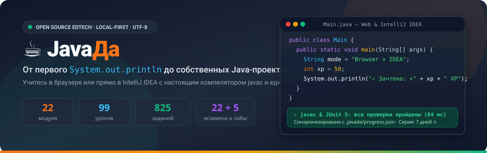

<div align="center">



<br/>

**[🇷🇺 Русский](../../README.md)** · **[🇬🇧 English](README.en.md)** · **[🇪🇸 Español](README.es.md)** · **[🇩🇪 Deutsch](README.de.md)** · **[🇨🇳 中文](README.zh.md)**

<br/>

[](#inicio-rápido)
[](../../java-trainer/idea-plugin/README.md)
[](../../java-trainer/android-app/README.md)
[](#inicio-rápido)
[](../../LICENSE)

**Lee menos «para después» — escribe código Java real desde la primera lección.**  
Entrenador interactivo local de Java con compilador `javac` real, verificación instantánea, gamificación y sincronización de progreso entre **Navegador**, **IntelliJ IDEA** y **Android**. Disponible en **5 idiomas (`RU`, `EN`, `ES`, `DE`, `ZH`)**.

</div>

---

## ✨ Por qué elegir JavaDa

| Ventaja | Cómo funciona |
| :--- | :--- |
| 🎯 **3 entornos — 1 perfil compartido** | Aprende en el **navegador**, dentro de **IntelliJ IDEA** (plugin nativo en Kotlin) o desde el móvil con la **app Android** (`Jetpack Compose`). Todo tu XP, rachas, logros y borradores se sincronizan mediante `.javada/progress.json`. |
| 🌍 **5 idiomas integrados** | Cambia el idioma de la interfaz y del curso en cualquier momento entre **Ruso (`RU`)**, **Inglés (`EN`)**, **Español (`ES`)**, **Alemán (`DE`)** y **Chino (`ZH`)**. |
| ⚡ **Compilador `javac` real y JUnit 5** | En PC tu código se compila con `javac` y se ejecuta en la JVM (con soporte UTF-8 y JUnit 5); en Android funciona un evaluador 100% offline (`OfflineTaskValidator`). |
| 🧠 **6 formatos interactivos de tareas** | Transcripción de código (`copy`), selección (`choice`), completar espacios (`fill`), emparejar conceptos (`matching`), constructor de código Parsons (`parsons`) y programación completa (`code`). |
| 🏆 **Mini-exámenes y retos Hardcore** | Cada lección incluye un reto opcional `★ Hardcore` (+90 XP) y cada módulo finaliza con un mini-examen sin pistas (aprobado con **80%**, bono de **310–520 XP**). |

---

## 🚀 Inicio rápido

### A. Versión Web (Navegador)
```bash
cd java-trainer
python3 -m venv .venv
./.venv/bin/python -m pip install -r requirements.txt
./.venv/bin/python server.py
```
Abre **[http://localhost:8000](http://localhost:8000)** y elige `ES · Español` en la barra superior.

### B. Plugin para IntelliJ IDEA (`java-trainer/idea-plugin/`)
```bash
cd java-trainer/idea-plugin
./gradlew buildPlugin
```

### C. Aplicación Android (`java-trainer/android-app/`)
```bash
cd java-trainer/android-app
./gradlew assembleDebug
```
